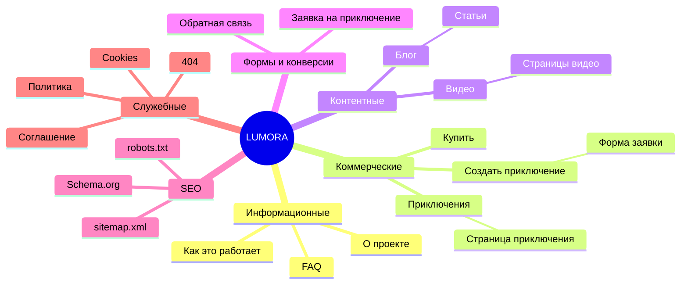

# 1. Структура сайта LUMORA

## Дерево страниц

```
/                                Главная
├── about/                       О проекте
├── games/                       Каталог приключений (поиск, фильтр по жанру, сортировка)
│   └── games/<slug>/            Страница приключения (6 демо-примеров)
├── create/                      Создать приключение (форма заявки)
├── how-it-works/                Как это работает
├── buy/                         Купить / условия заказа
├── blog/                        Блог (поиск, категории, теги)
│   └── blog/<slug>/             Статья (4 статьи)
├── videos/                      Видеотека (поиск, категории)
│   └── videos/<slug>/           Страница видео (3 подготовленные)
├── faq/                         Вопросы и ответы
├── contacts/                    Контакты и форма обратной связи
├── privacy/ · terms/ · cookies/ Правовые страницы (черновики)
└── 404.html                     Страница ошибки (noindex)
```

Админ-панели нет: сайт статический (GitHub Pages). Контент редактируется в файлах `src/data/*.mjs`, см. README.

## Таблица страниц

| Страница | URL | Назначение | Аудитория | Основной контент | Главный CTA | Связанные | Трафик | SEO-цель | Данные |
|---|---|---|---|---|---|---|---|---|---|
| Главная | `/` | Объяснить продукт, привести к заявке | все | hero, преимущества, шаги, примеры, видео, статьи, FAQ | Создать приключение | все разделы | бренд, прямой, соцсети | брендовые запросы | `adventures`, `articles`, `videos`, `faq` |
| О проекте | `about/` | Концепция, миссия, принципы | новые посетители | текст | Создать приключение | главная, games | бренд | «LUMORA», «о проекте» | статичный текст |
| Приключения | `games/` | Каталог, выбор жанра | заинтересованные | карточки, поиск, фильтры | Подробнее | карточки, create | коммерческий, соцсети | «интерактивное приключение на заказ» | `adventures` |
| Приключение | `games/<slug>/` | Показать пример | выбирающие | галерея, описание, параметры | Создать похожее | похожие, create, blog | видео, соцсети | запросы по жанру | `adventures` |
| Создать | `create/` | Конверсия: заявка | готовые к заказу | форма | Отправить заявку | how-it-works, privacy | все | не продвигается | форма |
| Как это работает | `how-it-works/` | Снять вопросы о процессе | сомневающиеся | 5 шагов, FAQ | Начать | create, games, faq | органика, блог | «как создать игру по личной истории» | `faq` |
| Купить | `buy/` | Условия заказа | готовые к покупке | оффер, условия | Оставить заявку | create, faq, privacy | коммерческий | «персональная игра» | текст |
| Блог | `blog/` | Информационный трафик | ищущие идеи | список, поиск, теги | Читать | статьи | органика | информационные кластеры | `articles` |
| Статья | `blog/<slug>/` | Ответ на запрос + перевод в продукт | органика | текст, CTA, связанные | Создать приключение | how-it-works, games, статьи | органика | основной запрос статьи | `articles` |
| Видео | `videos/` | Видеотека | зрители | карточки | Смотреть | videos/<slug> | видеоплатформы | — | `videos` |
| Видео-страница | `videos/<slug>/` | Плеер + связи | зрители | видео, ссылки на статью и пример | Создать приключение | статья, приключение | видео | — | `videos` |
| FAQ | `faq/` | Ответы | сомневающиеся | 11 вопросов, FAQPage | Задать вопрос | create, buy, privacy | органика, бренд | вопросные запросы | `faq` |
| Контакты | `contacts/` | Связь | все | форма, email | Отправить | faq | прямой | — | форма |
| Правовые | `privacy/ terms/ cookies/` | Юридическая база | все | текст | — | футер | — | не продвигаются | текст |

## Mind map



## Пользовательская навигация

- Шапка: О проекте · Приключения · Как это работает · Блог · Видео · FAQ · Контакты + кнопка «Создать приключение». На экранах уже 1140 px: бургер-меню.
- «Купить» вынесена в футер и ссылки со страниц приключений: не перегружает шапку.
- Хлебные крошки на всех внутренних страницах.
- У каждой страницы есть следующий шаг (CTA или «Читайте также»/«Похожие»). Скрипт `scripts/check.mjs` проверяет, что нет страниц без входящих ссылок.
