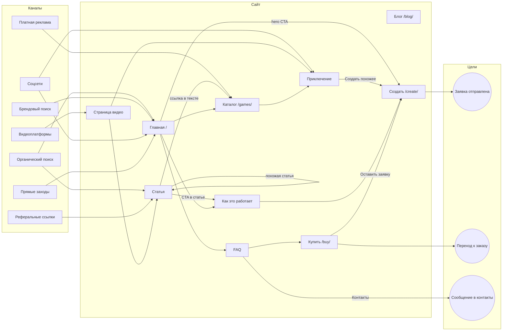

# 4. Карта трафика

## Визуальная карта

## Каналы привлечения

| Канал | Откуда | Куда попадает | Что нужно сделать | UTM |
|---|---|---|---|---|
| Органика | запросы из `05-seo.md` | статьи, главная | публиковать статьи, настроить Вебмастер | — |
| Соцсети | посты, ролики | главная, приключения | завести официальные аккаунты (пока не созданы) | `utm_source=<сеть>&utm_medium=social&utm_campaign=<кампания>` |
| Видео | ролики | страница видео | снять видео (пока не готовы) | `utm_medium=video` |
| Реферальный | блоги, каталоги, сообщества | статьи, главная | план в `05-seo.md` | `utm_medium=referral` |
| Прямой | адрес, закладки | главная | — | — |
| Бренд | запрос «LUMORA» | главная | Вебмастер, `Organization` | — |
| Платная | при необходимости | каталог, приключения | решение владельца | `utm_medium=cpc` |

## Пользовательские сценарии

| | Сценарий | Путь |
|---|---|---|
| A | информационный | запрос → статья → «Читайте также» → «Как это работает» → «Создать» |
| B | социальный | пост → главная → пример → каталог → заявка |
| C | видео | видео → страница видео → статья → приключение → CTA |
| D | коммерческий | коммерческий запрос → приключение → «Купить» → заявка |
| E | брендовый | «LUMORA» → главная → «О проекте» → FAQ → «Создать» |
| F | повторный | сохранённая ссылка → новая статья/приключение → заявка. **Рассылка не реализована.** |

## Точки конверсии и события Метрики

| Цель (идентификатор) | Где срабатывает | Реализовано в коде |
|---|---|---|
| `cta_create_hero / _header / _band / _article / _adventure / _video` | клик по CTA | да |
| `cta_example_hero` | «Посмотреть пример» | да |
| `create_view` | просмотр формы | да |
| `form_start` | первый ввод в форму заявки | да |
| `form_submit_success` | успешная отправка | да |
| `contact_form_start`, `contact_submit_success` | форма контактов | да |
| `adventure_view`, `video_view` | просмотр страницы | да |
| `video_play` | запуск плеера | да |
| `blog_to_adventure` | клик по ссылке на `games/` или `create/` из статьи | да |
| `checkout_start` | «Оставить заявку» на `/buy` | да |
| Подтверждённая покупка | — | **нет**: оплаты нет |

Цели нужно создать в интерфейсе Метрики (тип «JavaScript-событие») с теми же идентификаторами. Просмотры страниц Метрика считает сама. В событиях нет персональных данных и текстов историй. KPI не заданы: сначала собрать статистику, затем ставить числовые цели.
